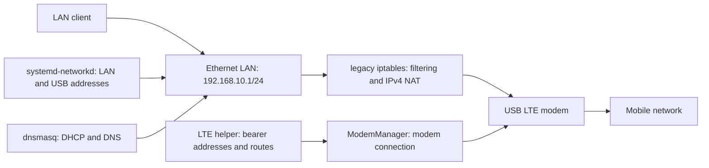

# STM32MP257F-DK LTE Router

Both dev-kit slots now have [r18 live MQTT telemetry and persistent TX/RX statistics](docs/mqtt-telemetry.md).

The dev kit now has [tested eMMC A/B root slots with r17 installed](docs/ab-flash-status.md).

[Signed remote updates](docs/remote-updates.md) support application releases and
OS/kernel releases, with compressed deltas. OS updates require provisioned and
boot-tested A/B slots; the existing partitions are not changed automatically.

The settings page includes an [IRMS MQTT V1.2 client](docs/mqtt.md) with broker,
credentials, TLS and device identity controls, telemetry and restricted proxies.
Hardware-specific remote operations require installed adapters as described in the guide.

The OpenWrt settings page supports [Ethernet LAN, WAN and simultaneous LAN/WAN VLAN modes](docs/ethernet-modes.md).

The OpenWrt settings page supports [DDNS with DynDNS and No-IP](docs/ddns.md).
It includes [port forwarding with source restrictions, ranges and NAT loopback](docs/port-forwarding.md).
An optional WAN DMZ host forwards unmatched incoming IPv4 traffic to one client.
Use [DHCP MAC-to-IP bindings](docs/dhcp-bindings.md) to reserve stable LAN addresses for devices.
It also has [OpenVPN client settings and certificate imports](docs/openvpn.md).

For a blank kit, see [the eMMC factory bundle and flashing instructions](docs/factory-image.md).
Build entry point: `openwrt/build-factory.py`; output: `local/router-factory-emmc.zip`.
The factory bundle passes offline checks but still needs a blank-board boot test.

The router now runs **OpenWrt on eMMC**: native UCI/netifd networking,
ModemManager LTE, firewall4 NAT, procd startup, and the existing authenticated
settings page. See [OpenWrt build, installation and recovery](docs/openwrt.md).
See the [flash and recovery record](docs/openwrt-flash-status.md) for the custom
eMMC layout and live checks. The board observations below describe the prior
OpenSTLinux installation, which is retained as a recovery boot option.

OpenWrt entry points: `openwrt/prepare-package.sh`, `openwrt/Makefile`,
`openwrt/provision.py`, and `web/openwrt_backend.py`. The OpenWrt settings page
uses **http://192.168.10.1:8081**, leaving LuCI's ports available.

## Existing OpenSTLinux installation

Initial learning project based on the saved conversation in `AI helper.docx`.
Target: OpenSTLinux on the Cortex-A35, Ethernet LAN, USB LTE WAN, IPv4 NAT,
DHCP/DNS and console-based status. This is a starter project, not a deployed router.

Selected modem: **Quectel EM060K-GL**. SIM: **Telstra**, APN:
**`telstra.extranet`**. LTE is connected; interface-bound ping, DNS and HTTPS tests
passed. Run `scripts/connect-lte.sh` on the board for an on-demand connection.
Ethernet LAN, DHCP/DNS and IPv4 NAT are active; a test client received a lease
and exchanged Internet traffic over LTE.
LTE boot/retry units are staged but not yet enabled.

Start with [the bring-up guide](docs/bring-up.md). Run the read-only
`scripts/board-status.sh` on Linux to identify the actual BSP, interface names,
network manager and installed tools before adapting the templates.

Files:

- `scripts/windows/Read-BoardConsole.ps1`: bounded serial capture, optionally sends Enter.
- `scripts/board-status.sh`: board and network diagnostics, no configuration changes.
- `config/`: example LAN, DHCP/DNS, forwarding and firewall configuration.
- `docs/bring-up.md`: staged setup, LTE connection, validation and recovery.
- [Modbus RTU collection and FTP upload](docs/modbus-collection.md): multi-meter CSV logging, scheduled uploads, retention, exports and OpenWrt setup.
- `yocto/router-packages.inc`: starting package selection for an existing ST BSP build.
- `docs/session-status.md`: observations from this PC and board.

LAN interface `end0` and MBIM modem interface `wwu1u1i8` were confirmed on the board.
QMI/MBIM drivers are installed; see [driver build notes](drivers/modem/README.md).
USB management is `usb0`, with board address `192.168.7.1`. The subnet must not overlap
another attached network. Ethernet must connect only to an isolated client or LAN.
NetworkManager remains masked because this build lacks the WWAN plugin. The kernel
lacks nftables IPv4/inet support, so the active firewall uses legacy iptables.
The authenticated [board settings page](docs/web-settings.md) is live at
**http://192.168.10.1**, with LTE/client status and DHCP/DNS settings.
It is started for the current session; boot persistence awaits approval.
Wi-Fi hotspot `STM32-LTE` now shares LTE Internet on 192.168.20.0/24, with hotspot
controls on the settings page. IPv6 routing and production hardening are later milestones.
