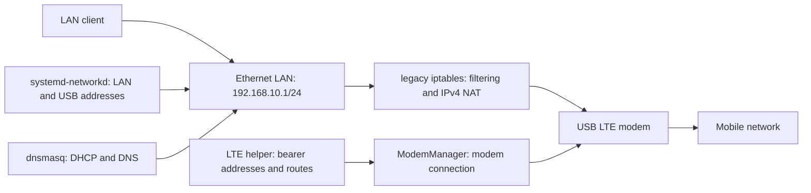

# STM32MP257F-DK LTE Router

Initial learning project based on the saved conversation in `AI helper.docx`.
Target: OpenSTLinux on the Cortex-A35, Ethernet LAN, USB LTE WAN, IPv4 NAT,
DHCP/DNS and console-based status. This is a starter project, not a deployed router.

Selected modem: **Quectel EM060K-GL**. SIM: **Telstra**, APN:
**`telstra.extranet`**. LTE is connected; interface-bound ping, DNS and HTTPS tests
passed. Run `scripts/connect-lte.sh` on the board for an on-demand connection.
Ethernet LAN, DHCP/DNS and IPv4 NAT are active; a test client received a lease
and exchanged Internet traffic over LTE.
LTE boot/retry units are staged but not yet enabled.

Start with [the bring-up guide](docs/bring-up.md). Run the read-only
`scripts/board-status.sh` on Linux to identify the actual BSP, interface names,
network manager and installed tools before adapting the templates.

Files:

- `scripts/windows/Read-BoardConsole.ps1`: bounded serial capture, optionally sends Enter.
- `scripts/board-status.sh`: board and network diagnostics, no configuration changes.
- `config/`: example LAN, DHCP/DNS, forwarding and firewall configuration.
- `docs/bring-up.md`: staged setup, LTE connection, validation and recovery.
- `yocto/router-packages.inc`: starting package selection for an existing ST BSP build.
- `docs/session-status.md`: observations from this PC and board.

LAN interface `end0` and MBIM modem interface `wwu1u1i8` were confirmed on the board.
QMI/MBIM drivers are installed; see [driver build notes](drivers/modem/README.md).
USB management is `usb0`, with board address `192.168.7.1`. The subnet must not overlap
another attached network. Ethernet must connect only to an isolated client or LAN.
NetworkManager remains masked because this build lacks the WWAN plugin. The kernel
lacks nftables IPv4/inet support, so the active firewall uses legacy iptables.
The authenticated [board settings page](docs/web-settings.md) is live at
**http://192.168.10.1**, with LTE/client status and DHCP/DNS settings.
It is started for the current session; boot persistence awaits approval.
Wi-Fi hotspot `STM32-LTE` now shares LTE Internet on 192.168.20.0/24, with hotspot
controls on the settings page. IPv6 routing and production hardening are later milestones.
