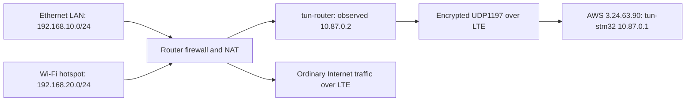

# STM32 router OpenVPN client and AWS server reference

Updated: 7 October 2026 (Australia/Sydney).

This document describes the OpenVPN client deployed on the STM32MP257F-DK
running OpenWrt, its settings and credentials, and the separate AWS OpenVPN
service created for it. Deployment and connection results below were recorded
on 6 October 2026. This documentation update did not recheck or modify the live
router or AWS server. A recorded connected state is not a live status guarantee.

## 1. Deployed system

The router establishes an outbound, certificate-authenticated IPv4 VPN over
its LTE Internet connection. OpenVPN creates a routed TUN interface; it does
not bridge Ethernet broadcasts or extend the local DHCP network into AWS.

| Component | Deployed value |
| --- | --- |
| Router application | `1.0.0-r9` |
| OpenVPN client package | `2.6.23-r1` |
| OpenSSL utilities | `3.0.22-r1` |
| ST firmware TUN driver | `kmod-tun 6.6.144-r1` |
| Authenticated settings page | `http://192.168.10.1:8081` |
| Public AWS VPN endpoint | `3.24.63.90:1197/UDP` |
| VPN address space | `10.87.0.0/24` |
| AWS tunnel interface/address | `tun-stm32`, `10.87.0.1/24` |
| Router tunnel interface | `tun-router` |
| Router tunnel address observed | `10.87.0.2` |
| Saved client enable state | Enabled |
| Last verified connection | Connected on 6 October 2026 |
| Internet default route | LTE; ordinary Internet traffic does not use AWS |



The router can initiate traffic to VPN addresses. Ethernet and Wi-Fi forwarding
are configured as described in section 6. AWS-initiated access to devices behind
the router is not configured. This deployment is an OpenVPN Community server
on EC2, rather than the managed AWS Client VPN service.

## 2. Client settings

These are the deployed saved settings. Fresh installations use the same server and cryptographic defaults, with the managed client disabled until provisioned.

| Setting | Current value | Meaning and supported choices |
| --- | --- | --- |
| OpenVPN service | Enabled | Starts the managed client. Enabled does not necessarily mean connected. |
| Destination IP or domain | `3.24.63.90` | Public server IPv4 address or DNS hostname. The application rejects unusable IPv4 destinations and malformed hostnames. |
| Port | `1197` | Destination server port, valid range 1-65535. Must match the server listener and AWS inbound rule. |
| Protocol | UDP | Client generates `udp4`; TCP generates `tcp4-client`. Changing to TCP also requires a matching TCP server and firewall rule. |
| VPN subnet | `10.87.0.0/24` | IPv4 destination range explicitly routed through the tunnel. It does not set the router's tunnel IP. Must be network-aligned CIDR, prefix /8 or longer, without overlap with the configured validation ranges `192.168.7.0/24`, `192.168.10.0/24`, or `192.168.20.0/24`. |
| Cipher | `AES-256-GCM` | Selected data-channel cipher and fallback. UI also supports AES-128-GCM, AES-256-CBC, and AES-128-CBC. Actual negotiation must agree with the server; the renderer advertises both AES-GCM choices plus the selected cipher. |
| Authentication digest | `SHA256` | Sets `auth SHA256`; UI also supports SHA1 and SHA512. This is a cryptographic digest setting, not a VPN login password. |
| Keepalive | `10 120` | Idle ping interval and receive timeout in seconds; see below. |
| nobind | Enabled | Does not reserve a fixed local UDP/TCP port. The router initiates the connection using an available source port. |
| Compression | Disabled | Fixed by the application with `allow-compression no`. |
| TLS key mode | None | Current service uses certificate TLS without an additional static TLS key. Other choices are `tls-auth` and `tls-crypt`; both require coordinated server changes and a matching `ta.key`. |
| Server certificate SHA256 fingerprint | Empty | Uses CA validation and requires the server certificate's TLS server purpose. A configured trusted fingerprint switches the renderer to certificate pinning. |
| Authentication method | SSL/client certificate | Fixed certificate-based authentication. No VPN username/password field or `auth-user-pass` is generated. |

AES-GCM provides data encryption and integrity together. The configured `auth`
digest does not supply a separate data-channel HMAC when an AEAD cipher such
as AES-GCM is used. TLS control-channel cipher negotiation is separate from
the data cipher; recorded negotiation was TLS 1.3 and AES-256-GCM for data.

### Keepalive `10 120`

The client sends an internal OpenVPN ping after 10 seconds without outgoing
traffic, and restarts its session after 120 seconds without receiving a ping
or other packet from its peer. These are VPN protocol messages, not ICMP echo
requests. They help maintain NAT mappings and detect broken LTE paths.

On a server, the same helper gives clients a 120-second receive timeout and
uses a 240-second server-side timeout. This gives clients time to reconnect
before the server expires the old session. The application accepts two whole
second values satisfying `1 <= interval < timeout <= 3600`.

OpenVPN option behavior is described in the
[OpenVPN 2.6 manual](https://openvpn.net/community-docs/community-articles/openvpn-2-6-manual.html).

### Fresh-install defaults

[`web/openvpn_client.py`](../web/openvpn_client.py) defaults to endpoint
`3.24.63.90:1197/UDP`, subnet `10.87.0.0/24`, AES-256-GCM, SHA256,
keepalive `10 120`, `nobind` enabled, no TLS static key, and an empty server
fingerprint. The UI subnet hint and first cipher choice match these defaults.

The enable default remains **disabled**: a new installation needs its own valid
client credentials and server admission before it can connect. The deployed
board remains enabled through its saved settings in
`/etc/router-web/openvpn/settings.json`. Saved values override application
defaults; updating the package does not migrate existing saved settings.
Installing the package alone does not provision certificates or AWS admission.

## 3. Certificates, private keys, and trust

A certificate contains an identity, a public key, validity dates, and a CA
signature. A private key proves possession of the corresponding identity.
The CA certificate is shareable trust material; the CA private signing key is
secret and is not needed by either endpoint during normal VPN operation.

### Credential inventory

| Material | Location and identity | Role and handling |
| --- | --- | --- |
| Router CA certificate | `/etc/router-web/openvpn/ca.crt`; CA CN `STM32 Router VPN CA 20261006` | Trusts the new AWS server certificate. Recorded expiry: 3 October 2036. Contains no private signing key. |
| Router client certificate | `/etc/router-web/openvpn/client.crt`; CN `stm32mp257f-router-20261006` | Presents the router identity to AWS; signed by the new CA with `clientAuth` extended key usage. Recorded expiry: 8 January 2029. |
| Router client private key | `/etc/router-web/openvpn/client.key` | RSA 2048-bit key generated on the router. Unencrypted PEM for unattended startup; remains on the router and was not exported during deployment. Protect as a secret. |
| Router certificate signing request | `/etc/router-web/openvpn/stm32-router.csr` | Public-key request generated from the router key. Sent to AWS for signing; does not contain the private key. Not needed for each connection. |
| AWS CA certificate | `/etc/openvpn/stm32-router/ca.crt` | Same CA trust certificate, used by AWS to validate the router certificate. |
| AWS CA signing key | `/etc/openvpn/stm32-router/ca.key` | RSA 3072-bit key encrypted with AES-256-CBC and a passphrase. Signs certificates; stays on AWS. Its encryption cipher is separate from VPN traffic encryption. |
| AWS server certificate | `/etc/openvpn/stm32-router/server.crt`; CN `stm32-vpn-server` | Signed by the new CA with `serverAuth` extended key usage. Creation script requested 825 days of validity; inspect the certificate for exact dates. |
| AWS server private key | `/etc/openvpn/stm32-router/server.key` | RSA 2048-bit key generated on AWS, unencrypted for unattended service startup. Stays on AWS. |
| Optional TLS static key | `/etc/router-web/openvpn/ta.key` | Not used by the current profile. Required only if `tls-auth` or `tls-crypt` is enabled on both ends. |
| Session traffic keys | Negotiated in memory | Established during TLS negotiation and renewed by OpenVPN. These are not the certificate private keys or the optional `ta.key`. |

AWS also retains the server CSR, router CSR, and certificate extension files
under its private PKI directory. The creation script uses SHA256 certificate
signatures, random certificate serials, `CA:FALSE` on endpoint certificates,
and explicit TLS client/server purposes.

The new CA passphrase is stored separately in the git-ignored, Windows ACL
protected workspace file `local/stm32-vpn-ca-passphrase.txt`. This document
intentionally contains no passphrase, private key, or PEM payload. The router
does not need the CA passphrase. Losing it prevents further signing with the
encrypted CA key, but does not itself stop an already configured VPN session.

### How the endpoints authenticate

1. The router contacts AWS over UDP1197 using LTE.
2. AWS presents its server certificate and proves possession of `server.key`.
3. With the current empty fingerprint setting, the router validates the server
   against `ca.crt` and requires TLS server certificate purpose.
4. The router presents `client.crt` and proves possession of `client.key`.
5. AWS validates the client against its CA, requires TLS client purpose, and
   requires the exact CN `stm32mp257f-router-20261006`.
6. OpenVPN establishes the encrypted tunnel and assigns the tunnel address.

The generated client does not add a server CN/hostname match directive.
Current server trust is based on the configured CA and TLS server purpose.
The observed router IP `10.87.0.2` is an allocation, not a documented static
reservation; neither the current client nor the recorded server profile
contains a per-client fixed-address configuration.

### Optional fingerprint and TLS static key modes

A server fingerprint is the SHA256 hash of the server certificate. The UI
accepts 64 hexadecimal digits or colon-separated hexadecimal pairs and
normalizes them. When set, the renderer uses `peer-fingerprint` instead of
`ca` plus `remote-cert-tls server`. This supports a trusted legacy certificate
without server-purpose extensions. Obtain a fingerprint through a trusted
channel; certificate replacement requires updating the pin.

`tls-auth` authenticates control packets using a shared static key; the client
renderer uses key direction `1`, requiring a compatible server direction.
`tls-crypt` additionally encrypts the control channel with that shared key and
does not use the direction argument. Neither replaces client certificates.
The present AWS service configures neither mode, so selecting either only on
the router would prevent connection. The importer supports OpenVPN Static
key V1 files, not `tls-crypt-v2` provisioning.

### Import and renewal procedure

1. Disable the managed OpenVPN client in the settings page.
2. Import each required file separately: CA certificate, client certificate,
   and matching unencrypted client private key. For the current router, keep
   its existing generated key when renewing a certificate for that key.
3. Import a TLS static key only when the server uses the matching mode.
4. Confirm endpoint, subnet, cipher, digest, and TLS settings; apply them.
5. Enable the client and confirm `connected`, a tunnel IP, and actual traffic.

Imports accept one relevant PEM block per certificate/key file, up to 16 KB.
The importer tolerates descriptive text before a PEM certificate, validates
certificate expiry and private-key syntax with OpenSSL, and writes fixed
filenames. Enabling checks required file presence, client certificate expiry,
and certificate/private-key public-key match. These local checks do not prove
that AWS will accept the certificate; TLS authentication performs trust and
purpose checks during connection. The deployment separately verified the
client CA chain and TLS client purpose.

Credential directories use mode `0700`; credentials and generated settings
use mode `0600`. API responses expose presence, filenames, and certificate
subject/expiry information, never private keys or PEM contents. The web login
is separate from VPN certificate authentication.

## 4. AWS changes made for this router

### Why a separate service was created

The EC2 host already ran other OpenVPN 2.4.12 services. The router was ultimately provisioned on its own UDP1197 service and independent PKI.

Existing on-disk certificates and configuration were inconsistent with the
long-running services: the server certificate at a configured path did not
verify against the CA at that path, and some client issuer names differed.
Those files could not establish what the processes had loaded in February.
The supplied old CA passphrase failed to decrypt five candidate CA-key
locations. No new router certificate was issued from that old PKI.

The user approved a separate service with new credentials. Existing services
were not restarted or modified during this deployment. An early
signing attempt left only the empty private directory
`/etc/openvpn/router-clients-20261006`.

### New service, PKI, and tunnel

| AWS change | Result |
| --- | --- |
| Created independent PKI directory | `/etc/openvpn/stm32-router`, mode `0700`; files mode `0600` |
| Created new CA and server credentials | New encrypted CA signing key, CA certificate, server key and server-purpose certificate |
| Signed router CSR | Issued the new client-purpose certificate without copying the router private key to AWS |
| Created dedicated server profile | `/etc/openvpn/server/stm32-router.conf`, mode `0600` |
| Added dedicated systemd unit | `/etc/systemd/system/openvpn-server@stm32-router.service` |
| Started and enabled service | `openvpn-server@stm32-router.service` enabled for startup |
| Added separate listener and subnet | UDP1197, `tun-stm32`, `10.87.0.0/24`, server `10.87.0.1` |
| Restricted client identity | Exact client CN `stm32mp257f-router-20261006` |
| Later increased connection slots | `max-clients 1` changed to `max-clients 2` for replacement handshakes |
| Added AWS security group inbound rule | UDP1197 from the router's observed LTE public IP `120.157.204.76/32` |

The custom systemd unit runs `/usr/sbin/openvpn --config` against the new
profile, starts after `network-online.target`, creates the private runtime
directory `openvpn-stm32-router`, uses `UMask=0077`, and restarts after failure
with a five-second delay. It is enabled under `multi-user.target`.

### Recorded server profile after the reconnect change

The following reconstructs the deployed profile from the creation script and
subsequent reconnect patch. It is documentation, not a newly fetched live file.

```conf
port 1197
proto udp
dev tun-stm32
dev-type tun
topology subnet
server 10.87.0.0 255.255.255.0
ca /etc/openvpn/stm32-router/ca.crt
cert /etc/openvpn/stm32-router/server.crt
key /etc/openvpn/stm32-router/server.key
dh none
ecdh-curve prime256v1
tls-version-min 1.2
remote-cert-tls client
verify-x509-name stm32mp257f-router-20261006 name
cipher AES-256-GCM
ncp-ciphers AES-256-GCM:AES-128-GCM
auth SHA256
keepalive 10 120
persist-key
persist-tun
max-clients 2
status /run/openvpn-stm32-router/status.log 10
status-version 2
verb 3
explicit-exit-notify 1
```

The server uses OpenVPN 2.4's `ncp-ciphers` option for AES-GCM negotiation.
`dh none` and `ecdh-curve prime256v1` configure ECDH rather than a separate
finite-field DH parameter file. TLS 1.2 is the minimum; TLS 1.3 was observed.
No default Internet route, DNS setting, compression option, TLS static key,
`duplicate-cn`, or `client-to-client` directive was added to this profile.

The second slot lets a replacement connection complete while a stale UDP
session occupies a slot. It does not admit a second router identity: the exact
certificate-name restriction remains. The previous profile was backed up at
`/etc/openvpn/server/stm32-router.before-reconnect.conf.backup`.

### AWS security group change and connection outcome

The new listener initially received no router packets during a 12-second
capture. The router's route to the endpoint used LTE, and HTTPS public-IP
discovery reported `120.157.204.76`. The user added this inbound rule to the
EC2 instance security group `launch-wizard-5` in the AWS console:

| Field | Value |
| --- | --- |
| Type | Custom UDP |
| Destination port | `1197` |
| Source IPv4 CIDR | `120.157.204.76/32` |

The `/32` permits that single public source IP; it is not the router's tunnel
IP or a LAN address. If the LTE public IP changes, the source rule must be
updated. No instance role or AWS CLI credentials were available for the
original security group change, so it was performed by the user.
AWS documents the protocol, port, and source fields in its
[security group rules reference](https://docs.aws.amazon.com/vpc/latest/userguide/security-group-rules.html).

After the rule was added, the tunnel connected automatically. Both AWS
`10.87.0.1` to router `10.87.0.2` and the reverse direction passed three-packet
ping checks without loss. LTE remained the Internet default route.

Recorded administrative access to the server uses the jump host
`jumpuser@54.252.89.129`, then `ec2-user@172.31.2.110`. The jump host and EC2
private address are administrative access paths, not router VPN destinations.

## 5. Client implementation and service lifecycle

| File or component | Purpose |
| --- | --- |
| `/etc/router-web/openvpn/settings.json` | Saved UI settings, overriding source defaults |
| `/etc/router-web/openvpn/client.conf` | Generated OpenVPN client configuration |
| `/etc/config/openvpn`, section `openvpn.router_vpn` | Managed native OpenWrt client instance and enable state |
| `/etc/config/firewall` | VPN firewall zone and forwarding rules |
| `/etc/init.d/openvpn` and procd | Native process supervision and startup |
| `/etc/hotplug.d/openvpn/30-router` | Publishes managed-client connection events |
| `/var/run/router-openvpn.connected` | Runtime marker containing OpenVPN process ID and tunnel address |
| `/var/run/router-openvpn.status` | OpenVPN status file, updated every 10 seconds |
| `/usr/lib/router-web/openvpn_client.py` | Validation, rendering, imports, activation, and API status implementation |

The generated profile uses `client`, `dev tun-router`, `dev-type tun`, the
selected protocol and remote, certificate/key paths, and `nobind` when enabled.
It includes `resolv-retry infinite`, `persist-key`, `persist-tun`,
`script-security 2`, `up-restart`, verbosity 3, and status format version 2.
UDP clients send `explicit-exit-notify 1` when stopped, helping the server
release sessions promptly. Certificate uploads cannot add arbitrary scripts.

The direct Enable/Disable button acts immediately on saved settings, even if
the settings form contains unsaved edits. Apply and toggle controls are
disabled while a change is in progress. The label represents enable state;
the connection badge separately reports:

| State | Meaning |
| --- | --- |
| `disabled` | Saved client enable state is off |
| `stopped` | Enabled, but no managed OpenVPN process is running |
| `connecting` | Managed process runs, but no matching connection marker exists |
| `connected` | Enabled running process has a matching native connection event and tunnel address |

The hook handles `route-up`, `down`, and `route-pre-down`. Status matches the
marker PID against the current procd instance, avoiding stale TUN addresses
being mistaken for an authenticated current session. A connected badge is
still not an end-to-end application traffic test. This firmware's BusyBox
`ip` lacks JSON output and its OpenVPN package lacks the management interface.

Authenticated, CSRF-protected API routes are `/api/openvpn`,
`/api/openvpn/toggle`, and `/api/openvpn/certificate`. The toggle accepts only
a boolean `enabled`. Imports are refused while the client is enabled.

Apply stages OpenVPN and firewall UCI configuration, refuses pending LuCI/CLI
changes, detects configuration changes during staging, writes saved/generated
files, checks the firewall, and reloads services. It preserves unrelated UCI
sections and reconciles native OpenVPN instances. On activation failure it
restores the original configuration and reloads services. Existing files are
also copied to `.previous` files in the private VPN directory before activation.

The native OpenVPN service is enabled for startup. The current managed instance
is enabled; fresh installations stay disabled until provisioned and enabled.
`/etc/router-web/` and `/etc/config/openvpn` are listed for sysupgrade retention.
Successful startup after a reboot was not tested during the recorded deployment.

## 6. Routing and firewall behavior

Only `10.87.0.0/24` is explicitly routed through the VPN. The renderer uses
`route-nopull` and `route 10.87.0.0 255.255.255.0 vpn_gateway`, ignoring pushed
routes and DNS options. LTE continues to carry Internet traffic, including the
outer UDP connection to AWS. This is a split-tunnel configuration.

The `router_vpn` firewall zone binds to `tun-router`, rejects input and
forwarding by default, allows router output, and enables masquerading and MTU
fixing. An IPv4 ICMP echo-request rule permits ping to the router through the
VPN. Ethernet `lan` to `router_vpn` forwarding is enabled; established return
traffic is handled by the firewall's connection tracking.

On 6 October a separate persistent rule, `firewall.wifi_vpn`, was added from
`hotspot` to `router_vpn`, with destination `10.87.0.0/24`, IPv4, all protocols,
and ACCEPT. It permits Wi-Fi devices to initiate traffic to that VPN subnet.
If the VPN subnet changes, update this rule's destination separately; the
managed client's apply function preserves it rather than rewriting its subnet.

Masquerading makes forwarded LAN/hotspot traffic appear at AWS as traffic from
the router's tunnel address. AWS does not need routes to those client LANs for
these outgoing, NATed connections. No VPN-to-LAN forwarding was enabled, and
the VPN does not expose the settings page, SSH, or serial/AT TCP bridges.
Wi-Fi and Ethernet client traffic was not tested from actual client devices.

## 7. Validation, backups, and deployment limitations

Recorded validation included 44 passing local tests and five existing tests
skipped on Windows. Live authenticated checks covered status, CSRF rejection,
invalid settings/imports, missing credentials on enable, disabled saves, file
permissions, firewall validation, LTE default route, and existing services.
The client CA chain, TLS client purpose, and key match were verified, as were
server TLS validation, TLS 1.3 negotiation, and AES-256-GCM data encryption.

Desktop/mobile headless browser checks covered the panel, settings payload,
certificate-file submission, JavaScript errors, layout overflow, and both
toggle directions with unsaved form values retained. Browser API responses
were fixtures; authenticated API behavior was separately checked on the board.
Installed application hashes matched this workspace at deployment.

| Backup | Recorded location |
| --- | --- |
| Original router configuration and application | `/root/router-before-openvpn-20261006/config-and-app.tar.gz`, mode `0600` |
| Firewall before Wi-Fi VPN access | `/root/firewall-before-wifi-vpn-20261006T042513Z` |
| AWS profile before second reconnect slot | `/etc/openvpn/server/stm32-router.before-reconnect.conf.backup` |

Dependencies are `openvpn-openssl` and `openssl-util`; OpenVPN selects `kmod-tun`.
Custom ST kernel modules must match the ST firmware build. A missing
`kmod-nf-conntrack-netlink` dependency was resolved using matching version
`6.6.144-r1`, and subsequent package dry-run/firewall checks passed. No kernel
or firmware partitions were replaced for this VPN deployment.

The IPK builder now assigns the declared release timestamp to installed source
files. Earlier zero timestamps could let Python reuse stale bytecode when a
source file retained the same size; reinstalling the corrected package resolved
the discovered mismatch. The factory builder overlays the application, but its
base image must contain VPN dependencies. The existing factory ZIP was not
rebuilt for this change.

## 8. Read-only diagnostics and common faults

Run these on the router over an existing authorized administrative session:

```sh
uci show openvpn.router_vpn
ubus call service list '{"name":"openvpn"}'
logread -e openvpn
ip -4 addr show dev tun-router
ip -4 route show
cat /var/run/router-openvpn.connected
ping -c 3 10.87.0.1
openssl x509 -in /etc/router-web/openvpn/client.crt -noout -subject -issuer -dates
openssl verify -CAfile /etc/router-web/openvpn/ca.crt -purpose sslclient /etc/router-web/openvpn/client.crt
```

A missing marker/interface is expected when disconnected. On AWS, read-only
checks include:

```sh
sudo systemctl status openvpn-server@stm32-router.service --no-pager
sudo ss -lunp
sudo journalctl -u openvpn-server@stm32-router.service -n 50 --no-pager
sudo cat /run/openvpn-stm32-router/status.log
sudo openssl x509 -in /etc/openvpn/stm32-router/server.crt -noout -subject -issuer -dates
```

| Symptom | Check |
| --- | --- |
| Client stays connecting with TLS timeout | LTE Internet connectivity; destination UDP1197; AWS listener; security group source matching the current LTE public IP; any host/network firewall |
| Certificate verification failure | Correct new CA, certificate validity, clock, TLS purpose, exact allowed client CN, and any configured server pin |
| Client refuses enable | Required PEM files, unencrypted key, certificate/key match, expiry, and VPN package availability |
| Connected but LAN/Wi-Fi traffic fails | Destination inside `10.87.0.0/24`, relevant forwarding rule, NAT, destination service firewall, and an actual client-device traffic test |
| AWS cannot access a LAN device or management page | Current VPN-to-LAN/input policy intentionally does not permit this; additional routes and explicit firewall access are required |
| Apply refuses settings | Pending UCI edits or concurrent configuration changes; apply/revert those edits before retrying |
| Repeated reconnects | LTE loss/address changes, logs, certificate reuse, server admission/slot limits, and keepalive behavior |

Do not restart or replace PKI for the other existing services to troubleshoot
this separate router service; their on-disk trust material remains historically
inconsistent with the running processes.

## 9. Future support for multiple routers

Multiple routers can share `3.24.63.90:1197`, but the recorded current service
is restricted to this one identity. The following changes are proposals and
have not been deployed by this documentation update:

- Generate a distinct private key and CA-signed client certificate with a unique
  CN for each router; keep each private key on its own router.
- Replace the exact single-CN server restriction with an admission policy for
  the intended identities, preserving CA and TLS client-purpose verification.
- Increase `max-clients` to suit the fleet and reconnect needs, and ensure the
  tunnel address pool has sufficient capacity.
- Add AWS UDP1197 access for each permitted public source address/range,
  accounting for changing LTE addresses.
- Provision the same server settings and CA certificate on each router, with
  its own client credentials. Assign distinct tunnel IPs, optionally using
  per-client fixed assignments.
- For AWS-initiated access to networks behind routers, plan non-overlapping
  site LAN ranges, server routes and per-client `iroute` entries, return routes,
  and router firewall permissions. Communication between sites also requires
  explicit client routes because this implementation ignores pushed routes.

The deployed `max-clients 2` reconnect adjustment does not by itself implement
fleet support. Detailed server routing and client identity options are in the
[OpenVPN 2.4 manual](https://openvpn.net/community-docs/community-articles/openvpn-2-4-manual.html).

## 10. Source references

- Client implementation: [`web/openvpn_client.py`](../web/openvpn_client.py).
- Settings UI: [`web/index.html`](../web/index.html) and [`web/app.js`](../web/app.js).
- HTTP API: [`web/server.py`](../web/server.py).
- Native event hook: [`openwrt/router-openvpn.hotplug`](../openwrt/router-openvpn.hotplug).
- Sysupgrade retention: [`openwrt/sysupgrade.keep`](../openwrt/sysupgrade.keep).
- Client option reference: [OpenVPN 2.6 manual](https://openvpn.net/community-docs/community-articles/openvpn-2-6-manual.html).
- Server option reference: [OpenVPN 2.4 manual](https://openvpn.net/community-docs/community-articles/openvpn-2-4-manual.html).
- OpenWrt setup reference: [OpenWrt OpenVPN client setup](https://openwrt.org/docs/guide-user/services/vpn/openvpn/client-luci).
- AWS inbound rules: [Amazon VPC security group rules](https://docs.aws.amazon.com/vpc/latest/userguide/security-group-rules.html).

Deployment reconstruction also used local operator scripts
`local/vpn-create-new-server.py`, `local/vpn-reconnect-fix.sh`,
`local/vpn-prepare-board.py`, `local/vpn-activate.py`, and
`local/enable-wifi-vpn.py`. These local files are deployment evidence rather
than a replacement for checking current running configuration.
