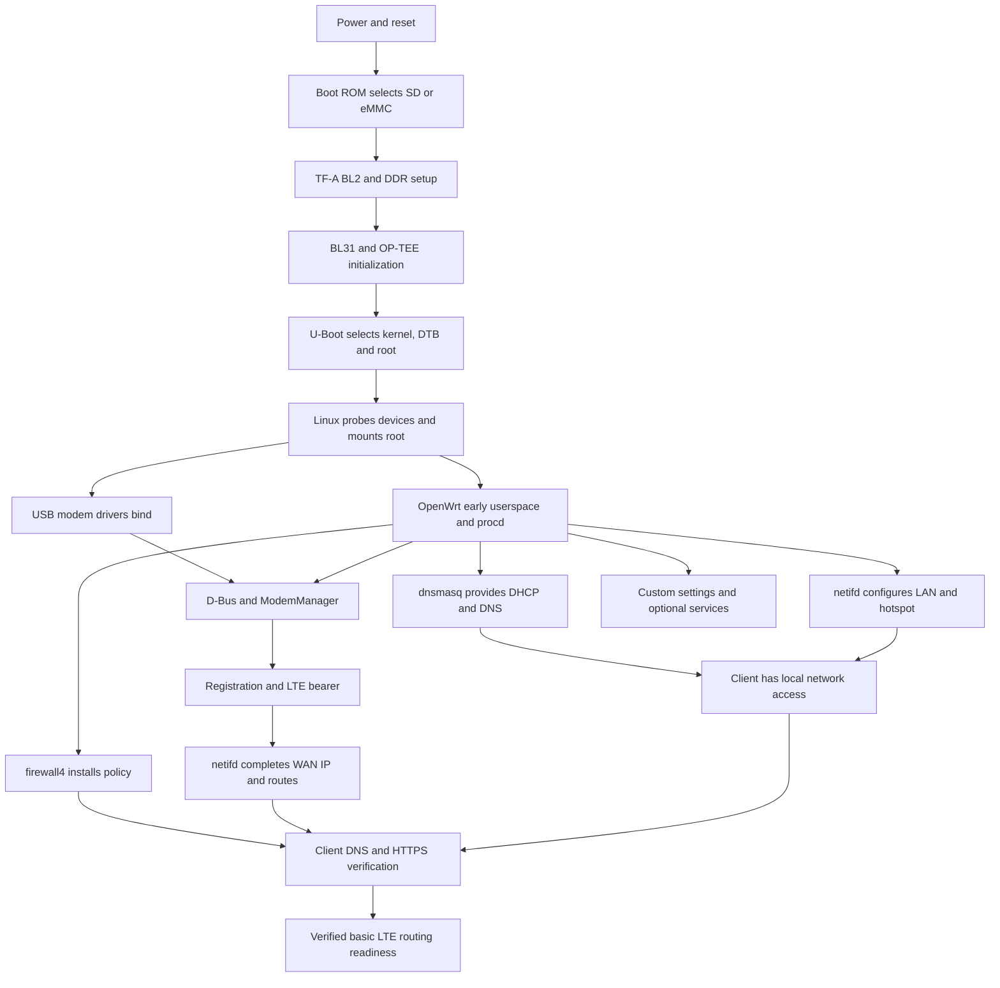

# STM32MP257F-DK LTE router: software layers and startup flow

Prepared: 27 October 2026 (Australia/Sydney).

## 1. What this document describes

The STM32MP257F-DK becomes an LTE router through several cooperating software systems. Boot firmware makes the processor and memory usable, Linux controls the hardware and forwards packets, OpenWrt configures the network, and a Quectel modem supplies the cellular connection. The custom Python application provides settings and additional services.

This guide describes **this project's recorded OpenWrt installation**, rather than a generic STM32 demonstration. Its sources are the repository's configuration, service scripts and deployment records, together with the upstream references in section 13. No live board inspection or new power-cycle test was performed while preparing this document.

### Recorded system identity

| Item | Recorded configuration |
| --- | --- |
| Main board | STM32MP257F-DK; Linux runs on the Cortex-A35 application processors |
| Router operating system | OpenWrt 24.10.8, release `r29233-443ec4032a` |
| Linux kernel | 6.6.144, from Bootlin's ST firmware release |
| Cellular modem | External Quectel EM060K-GL, connected through USB |
| Cellular configuration | Telstra SIM, APN `telstra.extranet`, IPv4, roaming disabled in the provisioning template |
| Ethernet LAN | `br-lan`, router address `192.168.10.1/24` |
| Wi-Fi hotspot | SSID `STM32-LTE`, `br-hotspot`, router address `192.168.20.1/24` |
| USB management | `192.168.7.1/24`, when the USB gadget is available |
| Custom settings application | Python server at `http://192.168.10.1:8081` |
| Latest recorded application release | `1.0.0-r12`, created 26 October 2026 |
| Latest recorded boot medium | SD card: actual SD boot confirmed on 26 October 2026 |

The earlier OpenWrt deployment boots from eMMC and remains available. The SD system was copied from that installation, with its own root partition identifier. The README's statement that the router runs on eMMC describes the earlier deployment; [the SD record](sd-current-system.md) is the later boot observation.

There are three different storage arrangements in this project. They must not be confused:

| Arrangement | Boot/root selection | Evidence and limitation |
| --- | --- | --- |
| Deployed custom eMMC installation | Existing ST boot chain; p6 bootfs; OpenWrt root on p9; former OpenSTLinux root on p8 | OpenWrt boots were verified; retained OpenSTLinux recovery entry was not boot-tested |
| Current SD copy | Bootlin SD bootloader/FIP/layout; copied kernel, DTB and application filesystem; expanded root on p5 | SD boot and approximately 57.5 GiB root filesystem confirmed on 26 October |
| Blank-board factory bundle | ST eMMC programming/boot firmware; OpenWrt root on p8; no OpenSTLinux recovery OS | Assembled and validated offline; blank-board boot still unverified |

See [eMMC deployment](openwrt-flash-status.md), [SD copy](sd-current-system.md), and [factory bundle](factory-image.md).

## 2. The complete stack at a glance

```text
 User / administrator
       |
 Custom web UI and Python API     LuCI / SSH / command-line tools
       |                                  |
       +------------ settings ------------+
                         |
               UCI configuration files
                         |
       procd + ubus + netifd + D-Bus + ModemManager
           |           |             |
       dnsmasq     firewall4       modem control
       wpad/AP     nft rules       MBIM / AT
           |           |             |
       Linux kernel: drivers, IP routing, netfilter, conntrack
           |                         |
 Ethernet / Wi-Fi / storage / USB     USB modem network device
                                     |
                         Quectel modem firmware + SIM
                                     |
                            Telstra LTE network

 Beneath Linux startup:
 Boot ROM -> TF-A BL2 -> secure runtime initialization -> U-Boot -> Linux
                         TF-A BL31 + OP-TEE
```

The secure-runtime box is a simplified view of the STM32MP25 AArch64 boot chain. BL31, OP-TEE and U-Boot are separate payloads, normally packaged in a FIP; section 5 explains their handoff and continuing roles. This diagram is not a measured execution trace.

Two kinds of activity run through the stack:

- **Control plane:** programs read settings and tell Linux and the modem what to do. Examples are selecting an APN, creating a bridge, assigning an address and installing a firewall rule.
- **Data plane:** the kernel moves packets between LAN and LTE using the resulting routes and rules. Ordinary forwarded packets do not pass through the Python web server, UCI, netifd or ModemManager.

## 3. Hardware and the lowest software layers

### 3.1 Processor, memory and peripherals

The Cortex-A35 cores execute the Linux operating system and router applications. RAM holds the running kernel, processes, packet buffers and connection-tracking state. SD/eMMC holds persistent boot images, applications and configuration.

Ethernet requires both the STM32 Ethernet controller and its external physical-layer hardware. Wi-Fi requires the onboard wireless hardware, its Linux driver and firmware. The LTE module is an external device; the discovery board does not become a cellular radio solely by installing Linux.

The STM32MP257 also has other processing resources, including a Cortex-M33. They may support other board functions, but the documented router's IPv4 forwarding does not require a custom Cortex-M33 routing program. A boot image may nevertheless include supporting firmware for board features.

### 3.2 Boot ROM

The Boot ROM is code built into the STM32 chip. It runs after reset, before any Linux filesystem exists. It interprets the hardware boot selection and attempts to load the next boot stage from the selected source. USB programming mode provides a path for an external programmer to load programming software.

The ROM does not know about DHCP, Wi-Fi passwords, APNs or NAT. Its job is to reach the next executable stage. Secure-boot authentication depends on device provisioning and policy; the presence of TF-A and OP-TEE alone does not establish that this board has authenticated boot enforced.

### 3.3 TF-A, OP-TEE and U-Boot

| Component | Main responsibility | Does it continue after Linux starts? |
| --- | --- | --- |
| TF-A BL2, first-stage bootloader | Early platform setup, including the path to usable DDR; load and hand off to later firmware payloads | BL2's loading work ends |
| TF-A BL31 | AArch64 secure monitor and low-level runtime services, including processor power-management interfaces | Yes, as resident secure firmware |
| OP-TEE, BL32 | Trusted execution environment and platform secure services/resource management | Yes, in the secure world |
| U-Boot, BL33 | Select OS boot entry, load kernel and device tree, prepare boot arguments and start Linux | Its normal bootloader role ends at handoff |

These are distinct from the Linux kernel. ST documents the STM32MP2 boot chain and its secure/nonsecure execution split in the [boot-chain overview](https://wiki.st.com/stm32mpu/wiki/Boot_chain_overview). The [TF-A STM32 platform documentation](https://trustedfirmware-a.readthedocs.io/en/latest/plat/st/stm32mpus.html) describes the FIP payloads, including BL31 on AArch64 platforms.

### 3.4 Device trees and peripheral firmware

A device tree is a structured description of hardware: controller addresses, interrupt connections, pin configuration, clocks, regulators and enabled devices. The Linux DTB tells the kernel which board hardware to instantiate. Earlier firmware stages can have their own device trees and configuration.

The DTB is neither a driver nor a router configuration. A correct driver can still fail to probe if its hardware description is wrong. Conversely, describing a modem-related USB controller does not replace the required USB networking driver.

Some peripherals need additional firmware files. In particular, the Wi-Fi driver/firmware and board calibration information must match the wireless hardware. The modem runs its own internal firmware, separate from Linux and from OP-TEE.

## 4. Linux and OpenWrt runtime layers

### 4.1 Kernel, drivers and network devices

Linux provides scheduling, memory management, filesystems, USB enumeration, hardware drivers and networking. A successful kernel boot is necessary but does not itself configure a router.

| Hardware or function | Relevant Linux support | What it exposes or enables |
| --- | --- | --- |
| SD/eMMC | MMC controller and block/filesystem drivers | Storage devices and mounted root filesystem |
| Ethernet | STM32 Ethernet MAC and PHY support | Ethernet network interface; physical member of `br-lan` |
| Onboard Wi-Fi | `brcmfmac`, wireless stack and matching firmware | Radio/network interface used by the hotspot |
| Modem USB data | `cdc_mbim` for the recorded MBIM composition | WWAN packet interface |
| Modem USB control | USB WDM support | A control endpoint such as `/dev/cdc-wdm0` |
| Modem serial functions | `option` USB serial support | Serial endpoints such as `/dev/ttyUSB*` |
| Alternate modem composition | `qmi_wwan`, if the modem uses QMI | QMI data path; not an extra requirement for an already working MBIM connection |
| IPv4 routing and firewall | IP stack, netfilter/nftables and conntrack | Forwarding, filtering, NAT and return-flow tracking |

The old OpenSTLinux interface names `end0` and `wwu1u1i8` are historical observations, not guaranteed OpenWrt names. USB enumeration can also change serial port numbering. OpenWrt configuration identifies the modem through its discovered sysfs device path rather than assuming that modem index `0` or a particular `ttyUSB` number is permanent.

Kernel modules must match the running kernel build and ABI. The modules compiled for the former OpenSTLinux 6.6.129 kernel cannot be reused as OpenWrt 6.6.144 modules.

### 4.2 Root filesystem and basic programs

The root filesystem supplies `/sbin/init`, libraries, shell utilities, service scripts, installed packages and `/etc` configuration. This project's deployed OpenWrt root is ext4; a generic explanation that assumes every OpenWrt installation uses a squashfs/overlay layout would be inaccurate here.

BusyBox supplies many basic command-line utilities. Shared libraries support programs such as ModemManager, Python and networking tools. None of these should be confused with the boot filesystem, which holds the kernel, DTB and boot selection files.

### 4.3 procd: starting and supervising services

OpenWrt's startup system uses procd. During early startup, OpenWrt mounts required filesystems and prepares the runtime environment; procd then manages normal services and enabled init scripts.

The project's custom scripts use `/etc/rc.common` and `USE_PROCD=1`. They register Python processes with procd and request restart after failure. Their startup priorities are:

| Service | Priority in repository | Gate before starting |
| --- | --- | --- |
| `router-web` | `START=95` | `/etc/router-web/configured` exists; initialization succeeds |
| `router-serial` | `START=96` | Serial JSON exists and its enabled check passes |
| `router-at` | `START=97` | `/etc/router-web/at-tcp.enabled` exists |

These numbers order invocation among enabled init scripts. They do **not** prove LTE is connected by that time. Modem registration, device discovery and interface setup are asynchronous. The web process has respawn configured so it can recover if its bind address is initially unavailable.

### 4.4 UCI, ubus and D-Bus

**UCI**, the Unified Configuration Interface, represents persistent settings in files such as `/etc/config/network`, `dhcp`, `wireless` and `firewall`. Saving a UCI setting and activating it are distinct operations: the responsible service must reload or reconfigure before runtime behavior changes.

**ubus** is OpenWrt's local communication bus for service APIs and events. netifd and other OpenWrt components use it to expose state and coordinate changes. LuCI commonly reaches system functionality through rpcd/ubus.

**D-Bus** is a separate communication bus used by ModemManager. The netifd ModemManager integration can use ModemManager's interfaces and tools to manage a connection. ubus and D-Bus do not carry the client's Internet payload.

### 4.5 netifd: the network configuration owner

netifd reads the network configuration, creates logical interfaces and bridges, applies addresses, manages interface lifecycle and coordinates protocol handlers. In this project it owns the WAN through the `modemmanager` protocol handler.

The logical interface `wan` is an OpenWrt configuration object. It is not necessarily the name of the kernel WWAN device. Similarly, `lan` is associated with `br-lan`, which contains the actual Ethernet device.

The provisioning template selects IPv4, APN `telstra.extranet`, route metric 20 and `peerdns=0`. Its dnsmasq configuration uses explicit DNS servers rather than automatically adopting carrier DNS. Later saved settings can override these initial defaults.

### 4.6 ModemManager and the modem firmware

ModemManager discovers the modem, groups its USB ports, identifies its capabilities, manages SIM/modem state and requests a cellular data connection. `mmcli` is an administrative client for that daemon.

For the recorded USB composition, MBIM provides the principal host-to-modem management protocol and USB packet transport support. AT commands provide other control/diagnostic functions. The modem's internal firmware handles the cellular radio stack, radio registration and communication with the carrier; Linux does not implement the EM060K-GL baseband.

An LTE **bearer** represents a data session. Its information can include IP addressing, gateway, DNS and MTU. Depending on the modem's reported IP method, the host may apply returned static values or use a dynamic addressing step. netifd's protocol integration completes the host network setup; a ModemManager state of connected alone does not prove that client routing works. See the upstream [LTE IP connectivity explanation](https://modemmanager.org/docs/modemmanager/ip-connectivity-setup-in-lte-modems/).

### 4.7 dnsmasq: DHCP and DNS

dnsmasq gives LAN clients addresses and network options, and provides DNS forwarding/cache service. The default Ethernet and hotspot pools are `.50` through `.200`, with 12-hour leases. DHCP MAC-to-IP bindings provide stable client addresses where configured.

For example, an Ethernet client may receive `192.168.10.119/24`, gateway `192.168.10.1` and the router as its DNS server. This supplies the client with a path to the router; it does not establish that LTE is available.

USB management uses a separate pool and deliberately advertises no default gateway or DNS server. It provides management access without telling the attached PC to route Internet traffic through that USB link.

### 4.8 Wi-Fi AP software

OpenWrt's wireless management and wpad/hostapd functionality configure the radio, advertise the SSID and perform WPA2 authentication. The driver and wireless firmware perform lower-level radio work. The AP's data interface joins `br-hotspot`.

The documented topology uses Australia regulatory settings, 2.4 GHz channel 6 and WPA2. Wireless station isolation and firewall separation are different controls: station isolation restricts communication between hotspot clients; firewall policy restricts hotspot access to Ethernet/USB networks and router services.

### 4.9 firewall4, nftables, routing and NAT

firewall4 translates OpenWrt's firewall configuration into nftables rules. The kernel evaluates those rules while handling traffic. firewall4 is the rule generator; nftables/netfilter is the runtime packet-processing mechanism.

The project allows IPv4 forwarding from LAN and hotspot to WAN and enables WAN masquerading. Masquerading replaces a client's private source address with the current WAN address. Connection tracking records the flow so reply packets can be translated back to the original client.

Filtering and routing remain separate decisions: a route determines an outgoing path; firewall policy decides whether the packet is permitted. Both must work. IPv4 forwarding must also be enabled in the kernel.

WAN administration is blocked by the documented policy. Later project changes permit ICMP echo requests and explicitly enabled services, including the recorded TCP serial and AT listeners. Port forwards and the optional DMZ host create additional selected inbound paths. Therefore, a description saying all inbound WAN traffic is blocked would be wrong.

The router does not configure IPv6 routing. A carrier-assigned IPv4 address is not guaranteed to be publicly reachable: carrier NAT or carrier filtering can still block inbound connections. Local port forwarding cannot remove carrier NAT.

### 4.10 Custom application and optional services

The custom package `stm32-lte-router` installs the Python application and static HTML/CSS/JavaScript under `/usr/lib/router-web`. Its OpenWrt backend adapts settings operations to UCI and native services. Persistent application state is under `/etc/router-web`.

The application supplies authenticated status/settings, account management, modem diagnostics, DHCP/DNS and hotspot settings, and the project's later DDNS, port-forwarding, DHCP binding and OpenVPN features. Its API includes session and CSRF protections. Web credentials are separate from the OpenWrt root account used for SSH/LuCI.

Additional services have their own roles:

| Feature | Software path | Required for basic LTE routing? |
| --- | --- | --- |
| DDNS | DDNS scripts and configured provider | No; publishes a changing address under a hostname |
| OpenVPN client | OpenVPN/OpenSSL plus routing/firewall integration | Only if the selected operating policy requires the VPN |
| TCP serial bridge | `router-serial`, Python `serial_tcp.py`, normally TCP 5000 | No; forwards application bytes to an external USB serial converter |
| AT TCP server | `router-at`, Python `at_tcp.py`, normally TCP 11111 | No; provides modem commands and reserved router commands |
| LuCI | OpenWrt web administration stack | No; alternative administration interface |
| SSH | Dropbear | No; remote administration and diagnostics |

TCP 5000 is a transparent serial data service. TCP 11111 handles AT commands, with `AT$` commands reserved for router software. These are separate from normal routed traffic, and the serial converter is separate from the LTE modem's own USB serial ports.

## 5. Startup from power application to Linux

The following is the expected dependency flow for the recorded platform. Exact boot messages, firmware versions and timing require a new serial capture; they are not inferred from the application version.

### Step 1: Power stabilizes and reset is released

Power-management hardware supplies the rails and the processor begins execution from ROM. Invalid power or reset conditions can prevent any software progress. Neither a web page nor a DHCP service exists yet.

### Step 2: Boot ROM selects the boot source

The boot pins select the primary boot path. The project records Cortex-A35 SD boot as `BOOT[3:0]=0001` and eMMC boot as `0010`; forced USB programming uses `0000`. Physical switch orientation must follow the board's markings and UM3385, not an assumed left/right direction.

The ROM loads the appropriate first-stage image. Failure here normally means Linux never starts and a root-filesystem fix cannot solve the problem.

### Step 3: TF-A BL2 establishes the early execution environment

BL2 performs the board-specific early setup needed to continue booting, including memory initialization, and obtains later payloads from the selected storage. The FIP is a package of firmware images; it is not the OpenWrt root filesystem.

The precise hardware initialization is divided among ROM, BL2, secure firmware and later drivers. It is misleading to attribute every clock, regulator and peripheral action to U-Boot alone.

### Step 4: Secure firmware initializes and hands off to U-Boot

For STM32MP25's AArch64 architecture, the boot flow establishes TF-A BL31 and OP-TEE BL32 before entering the normal-world bootloader, U-Boot BL33. BL31 provides the secure monitor; OP-TEE provides the trusted OS and relevant platform services. They remain resident as Linux runs in the nonsecure world.

### Step 5: U-Boot chooses the operating-system entry

U-Boot initializes the access it needs to storage and reads the boot configuration. In the custom eMMC installation, `/mmc1_extlinux/extlinux.conf` offers OpenWrt by default and a retained OpenSTLinux recovery entry.

The SD copy has its own extlinux entries selecting the SD root PARTUUID. That distinction matters because both SD and eMMC can contain a similar OpenWrt filesystem. Merely loading a kernel from SD would not prove the root filesystem also came from SD.

### Step 6: U-Boot loads the kernel and Linux DTB

The selected entry supplies the kernel image, the matching board DTB and boot arguments, including the root partition identifier. On the custom eMMC installation the new kernel and DTB live under `/openwrt/` on the retained bootfs.

U-Boot passes control to the kernel. A wrong root argument can stop boot or select the wrong installation; a wrong DTB can leave essential devices unavailable.

### Step 7: Linux initializes and mounts its root filesystem

The kernel initializes memory management, interrupts, scheduling and its device model. Built-in drivers probe; loadable drivers become available through the boot/runtime module-loading mechanisms. Storage and filesystem support allow Linux to mount the selected ext4 root.

Driver initialization can continue as userspace starts. In particular, USB devices and modem ports may appear later than the root filesystem. Mounting `/` successfully means Linux can proceed to userspace; it does not mean LTE is connected.

## 6. Startup from userspace to network readiness

### Step 8: OpenWrt initializes userspace

Early userspace prepares pseudo-filesystems, temporary directories and device handling. OpenWrt transitions into normal procd-managed operation. Logging, ubus, D-Bus and enabled services are brought up through their startup paths.

One-time provisioning must be distinguished from normal boot. The already configured SD/eMMC installation reads its saved settings; it does not run `provision.py --install` on every restart.

The separate factory image has first-boot initialization and a modem-discovery helper. It generates per-board state and discovers the modem path; its web startup is gated on successful initialization. That factory-specific path is not evidence that the same first-boot work runs on the current SD clone.

### Step 9: Local networking, firewall and Wi-Fi are configured

netifd reads the saved configuration, creates `br-lan` and `br-hotspot`, attaches their available member devices and applies `192.168.10.1/24` and `192.168.20.1/24`. Optional USB management is configured if its gadget interface exists.

Wireless software brings up the AP using the saved SSID, regulatory settings and key. dnsmasq starts serving the configured local networks. firewall4 installs the current policy; interface events can cause later rule updates as WAN devices become available.

These activities overlap with modem initialization. The desired policy is applied as networking comes up, but this document does not claim a measured interval in which all interfaces are already protected during this particular boot. Readiness checks must inspect the active firewall, not merely assume an init script ran.

At this point a client may obtain a local address and open the settings page even while the mobile network is unavailable.

### Step 10: USB enumerates the LTE modem

The USB host detects the EM060K-GL. Linux reads its descriptors and binds drivers to the functions exposed by its USB composition. For MBIM this includes a control endpoint and a packet interface; serial functions can also appear.

Driver binding is an essential intermediate milestone. Seeing the modem in a USB device list does not prove that the MBIM driver is present, that ModemManager recognizes the device or that a data session exists.

### Step 11: ModemManager discovers and prepares the device

ModemManager identifies the modem and its related ports, reads capabilities and determines SIM/modem state. A SIM PIN requirement, missing SIM, disabled radio or discovery failure can block this stage.

The configured netifd WAN protocol must refer to the actual modem sysfs path. A changed USB topology can invalidate a saved path. The factory helper explicitly addresses automatic discovery, whereas the ordinary provisioned setup depends on its configured device selection.

### Step 12: Cellular registration and data-session setup occur

The modem registers with an allowed mobile network. netifd's ModemManager integration requests the configured IPv4 data connection using `telstra.extranet`. The modem and carrier establish the LTE data session and expose its bearer information.

Registration and data-session establishment are separate milestones. A modem can report a signal or a registered network while still having no usable IP session. Antennas, coverage, SIM subscription, APN authorization and roaming policy all influence success.

### Step 13: Host WAN addressing and routing become usable

The protocol integration completes the required IP setup on the modem's packet interface and publishes the resulting WAN state to netifd. The routing table obtains the usable default route, and associated firewall/interface handling reflects the available WAN.

The template's metric helps rank that route if another default route exists. DNS forwarding uses the configured upstream servers. Internet access now requires those servers and destinations to be reachable over the established route.

### Step 14: Application and optional services become available

procd starts the enabled custom Python services according to their gates. The settings service runs its initializer before starting the server. DDNS and VPN behavior depends on their saved enablement, configuration and network availability.

The startup priorities `95`, `96`, `97` do not serialize these services behind a successful cellular connection. They can start before WAN is ready and respond to later availability. DDNS publication or VPN connection may complete after basic LTE routing.

### Step 15: A client proves end-to-end routing

The client acquires an address, gateway and DNS service. A DNS lookup and an HTTPS request from that client exercise the complete path: local access, router forwarding, NAT, LTE transport and reply handling.

Successful Internet access initiated by the board proves less: it does not test the client's DHCP settings, the forwarding chain, hotspot isolation or LAN-to-WAN NAT.

No fixed boot-to-ready time is asserted. Linux startup can finish before cellular registration, and carrier availability can dominate the remaining delay.

## 7. Startup dependency diagram



The branches express dependencies and overlapping work, not exact init-script ordering. Firewall policy must also be checked against the intended isolation requirements.

## 8. What happens to a client's packet

Consider an Ethernet client at `192.168.10.119` opening an HTTPS website.

1. **Address setup:** the client already received its address, gateway and DNS settings from dnsmasq.
2. **Name resolution:** the client asks the router's DNS service for the website address. dnsmasq answers from cache or sends a query to an upstream DNS server using the router's network stack.
3. **Local delivery to the router:** the client sees the website is outside its subnet. It discovers the gateway's MAC address using ARP and sends the frame to the router's Ethernet interface.
4. **Kernel routing:** Linux receives the IP packet and looks up a path toward the destination. The default route leads to the active LTE packet interface.
5. **Forwarding policy:** netfilter checks whether LAN-to-WAN forwarding is permitted. Connection tracking creates or updates state for the flow.
6. **Source NAT:** WAN masquerading rewrites the private client source address and, where needed, its source port. The kernel records the mapping.
7. **USB transport:** the WWAN driver sends the packet over USB to the modem. The modem firmware carries it over the LTE connection and carrier network.
8. **Reply:** a response reaches the modem and comes back through USB. Connection tracking reverses the NAT mapping and permits the established reply, subject to the installed policy.
9. **LAN delivery:** Linux routes the translated packet back to `192.168.10.119` and transmits the Ethernet frame.

For a Wi-Fi client, the beginning and end use the AP interface and `br-hotspot`. The routing/NAT mechanism is otherwise similar.

The forwarded HTTPS session remains between client and website; the settings application's HTTP server does not proxy or decrypt it. Router-targeted DNS requests and TCP serial/AT sessions are different: they are delivered to local userspace services rather than forwarded as ordinary LAN Internet traffic.

## 9. What “ready as a router” means

Readiness has several levels. Treating them separately makes troubleshooting more precise.

| Level | Required evidence | What it still does not prove |
| --- | --- | --- |
| Boot ready | Correct Linux and root filesystem are running | Network setup or LTE connectivity |
| Local network ready | Correct bridge addresses, Ethernet link/AP and DHCP/DNS service | Usable mobile data |
| LTE ready | Recognized modem, registered network, connected bearer and WAN IP configuration | Client forwarding or correct firewall isolation |
| Board Internet ready | Board can reach an IP destination, resolve DNS and complete HTTPS using LTE | A client can use the router |
| Routing ready | Ethernet/Wi-Fi client obtains settings and completes DNS/HTTPS via LTE | All security policies, inbound features or persistence |
| Operating policy verified | Expected isolation, enabled inbound rules and any required VPN work | Recovery after future device/network failures |
| Restart/recovery verified | Repeat after cold boot and modem reconnect | Unlimited availability under all carrier or hardware faults |

The eMMC record establishes successful OpenWrt boots, automatic LTE reconnection, hotspot/application startup and board Internet checks. It explicitly says physical client forwarding was not tested during that deployment. Older OpenSTLinux client tests establish that older system's behavior, not automatic proof for every later OpenWrt image.

The 26 October SD record confirms the selected SD root, capacity and running application/serial/AT services. It does not separately establish a fresh complete Ethernet/Wi-Fi forwarding and isolation test. The blank-board factory bundle still requires its own hardware boot validation.

## 10. Read-only checks and common failure points

Run these examples on the board through an authorized console or SSH session. They inspect state rather than reconfigure it. Output can contain device identifiers or network details and should be handled accordingly.

```sh
# Confirm operating system, kernel and selected root.
cat /etc/openwrt_release
uname -r
cat /proc/cmdline
mount
df -h /

# Inspect logical and physical networking.
ip link
ip -4 addr
ip -4 route
ifstatus wan
ubus call network.interface.lan status
ubus call network.interface.hotspot status

# Discover actual modem indices before selecting one.
mmcli -L
mmcli -m 0

# Inspect live policy and forwarding state.
nft list table inet fw4
cat /proc/sys/net/ipv4/ip_forward

# DHCP and startup logs.
cat /tmp/dhcp.leases
logread
dmesg
```

Replace `0` with the actual modem index returned by `mmcli -L`. Firewall output and logs can be long; inspect the relevant sections. `fw4 check` can additionally validate the saved configuration's generated rules without loading them, but generated-rule validity is different from inspecting the currently active rules.

| Symptom | Layer to inspect first | Reason |
| --- | --- | --- |
| No early boot progress | Power, boot selection, ROM/BL2 path | Linux may never have been loaded |
| U-Boot works; kernel cannot mount root | Boot arguments, PARTUUID, storage/filesystem support | Kernel may target an unavailable or wrong partition |
| System boots into unexpected settings | Actual mounted root and selected boot entry | SD kernel and eMMC root can be mixed if boot arguments are wrong |
| Modem appears on USB but not in `mmcli -L` | USB composition, drivers, ModemManager discovery | USB presence alone is insufficient |
| Signal shown but WAN remains down | SIM state, registration, APN, bearer and netifd protocol | Radio status is separate from usable data |
| WAN up but board has no Internet | Host IP setup, default route, carrier path and DNS | A bearer can exist without complete host connectivity |
| Board Internet works; client Internet fails | DHCP options, forwarding, NAT and zones | Board-originated traffic bypasses the client forwarding path |
| IP destinations work; names fail | Client DNS options and dnsmasq/upstream reachability | Routing may be healthy while DNS is broken |
| Wi-Fi SSID missing | Radio detection, firmware, saved wireless settings, wpad | LTE is not responsible for AP advertisement |
| Web page unavailable; client Internet works | `router-web` gate, process, bind address, port 8081 and input rule | Web administration and forwarding are separate functions |
| Inbound remote connection fails | Listener, input/DNAT policy, current address and carrier NAT | Working outbound NAT does not establish inbound reachability |
| Configuration disappears after restart | UCI commit, application persistence and selected boot medium | Runtime changes or edits to the other filesystem are insufficient |

## 11. Earlier OpenSTLinux implementation

OpenSTLinux was the first router environment used in this project. It is a Linux distribution assembled using ST's Yocto-based BSP. OpenWrt is another Linux distribution with its own network/service management. They share some component names but use different integration.

| Function | Earlier OpenSTLinux system | Current OpenWrt system |
| --- | --- | --- |
| Recorded kernel | 6.6.129 | 6.6.144 |
| Init/service supervision | systemd units | procd/init scripts |
| LAN configuration | systemd-networkd | netifd and UCI |
| LTE configuration | ModemManager plus `connect-lte` helper | netifd ModemManager protocol integration |
| Firewall | Legacy iptables; kernel lacked required nftables family support | firewall4 generating nftables rules |
| DHCP/DNS configuration | Direct dnsmasq configuration files | OpenWrt `/etc/config/dhcp` integration |
| AP management | Dedicated hostapd/hotspot service | OpenWrt wireless/netifd/wpad |
| Custom web address | `http://192.168.10.1` | `http://192.168.10.1:8081` |
| Application state | `/var/lib/router-web` | `/etc/router-web` |

The earlier record says several OpenSTLinux services were active only for the session and boot persistence was incomplete. Later OpenWrt records show automatic startup was enabled and tested for that deployment. Those statements describe different systems and dates.

Do not run the old LTE helper or install the old systemd/iptables templates on OpenWrt. They would compete with the native network ownership described here. NetworkManager is also not an additional required layer in the current router design.

## 12. Build tools versus software that runs on the router

The tools used to create and install a system are not all part of its runtime.

| Tool/artifact | Role | Runs for each normal router boot? |
| --- | --- | --- |
| STM32CubeProgrammer | Transfers programming firmware and writes images in USB programming mode | No |
| ST-LINK and Windows serial tools | Console/debug access from the host | No; normal routing does not require a connected PC |
| Bootlin ST OpenWrt feed | Board support, package overrides and image build integration | Build inputs do not run as a service |
| OpenWrt build system/cross compiler | Builds target binaries, kernel, modules and images | No |
| `openwrt/prepare-package.sh` | Stages this application's sources into a build tree | No |
| `openwrt/build-ipk.py` | Packages the architecture-independent application | No |
| `openwrt/provision.py` | Creates/installs router settings on an OpenWrt target | Setup operation, not ordinary recurring boot |
| `openwrt/build-factory.py` | Assembles the blank-eMMC flash bundle | No |
| TF-A/FIP/U-Boot | Starts the board and selected OS | Yes, along the selected boot path |
| Linux, procd, network services | Runtime operating environment | Yes |

The recorded eMMC deployment combined Bootlin prebuilt firmware, matching target packages and this project's Python application. It was not a full firmware compilation performed locally. Installing an application IPK on OpenSTLinux would not turn it into OpenWrt; boot firmware, kernel, root filesystem and configuration must form a compatible system.

The custom eMMC layout and copied SD system retain a guard against stock SD-image sysupgrade. This is a layout compatibility constraint: boot/root partition assumptions must be respected when replacing firmware. A rootfs image alone also cannot initialize a completely blank board's entire boot chain.

## 13. Sources and further reading

### Project sources

- [OpenWrt architecture, installation and validation](openwrt.md).
- [Custom eMMC layout, boot evidence and recovery limits](openwrt-flash-status.md).
- [Current SD installation and confirmed boot](sd-current-system.md).
- [Blank-board factory bundle and its test status](factory-image.md).
- [Application release identities](software-versions.md).
- [Package dependencies and installed paths](../openwrt/Makefile).
- [Provisioned topology, DHCP options, firewall zones and wireless defaults](../openwrt/provision.py).
- [Web startup and respawn behavior](../openwrt/router-web.init), [serial startup](../openwrt/router-serial.init), and [AT startup](../openwrt/router-at.init).
- [Serial data bridge](serial-tcp.md), [AT TCP service](at-tcp.md), [DDNS](ddns.md), [OpenVPN](openvpn.md), [port forwarding](port-forwarding.md), and [DHCP bindings](dhcp-bindings.md).

### Upstream primary references

- [ST UM3385: STM32MP257F-DK user manual](https://www.st.com/resource/en/user_manual/um3385-discovery-kit-with-stm32mp257f-mpu-stmicroelectronics.pdf): board hardware and boot selection.
- [ST boot-chain overview](https://wiki.st.com/stm32mpu/wiki/Boot_chain_overview): STM32MP2 boot architecture.
- [ST TF-A overview](https://wiki.st.com/stm32mpu/wiki/TF-A_overview): firmware-stage responsibilities.
- [TF-A STM32 platform documentation](https://trustedfirmware-a.readthedocs.io/en/latest/plat/st/stm32mpus.html): STM32 firmware packaging and boot stages.
- [Bootlin ST OpenWrt feed](https://github.com/bootlin/openwrt-feed-st): ST BSP integration and STM32MP257F-DK profiles.
- [OpenWrt ModemManager protocol handler, 24.10 branch](https://github.com/openwrt/packages/blob/openwrt-24.10/net/modemmanager/files/lib/netifd/proto/modemmanager.sh): WAN integration implementation.
- [ModemManager documentation](https://modemmanager.org/docs/modemmanager/): daemon, detection, control interfaces and IP setup.
- [OpenWrt procd source](https://git.openwrt.org/project/procd.git), [netifd source](https://git.openwrt.org/project/netifd.git), and [firewall4 source](https://git.openwrt.org/project/firewall4.git): authoritative implementations of service management, network management and firewall generation.

Hardware-specific status statements in this guide come from the dated project records. General architectural explanations describe the expected component behavior; they are not a substitute for a new serial boot trace or end-to-end client test.
